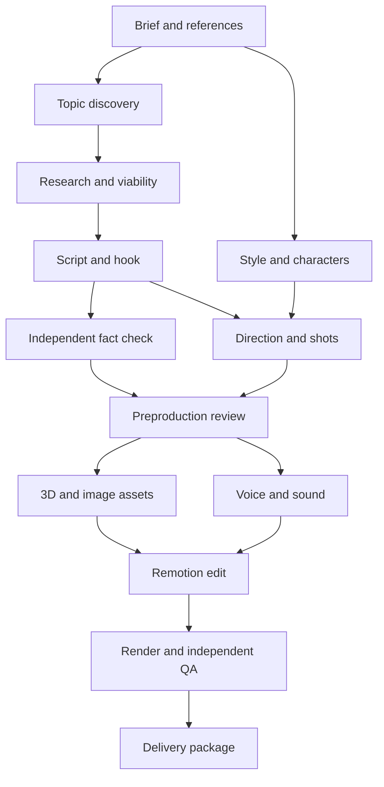

# StoryForge

**A local multi-agent production library for researched YouTube Shorts and long-form videos, built around Codex, Claude Code, Remotion, and Three.js.**

StoryForge gives the model a production team, a shared brief, a durable task graph, and concrete handoff contracts. It asks for your niche, approximate duration, format, audience, and references. It researches several angles, develops a hook and script, directs the scenes, creates or acquires assets and narration, edits and renders the film, reviews it, and assembles a delivery package.

This is version **0.1.0**, a working local foundation with **16 pipeline stages**, **18 role cards**, native agent definitions for both hosts, and a reusable scene renderer. The coordinator, CLI transports, artifact checks, and procedural scenes are implemented. Live research and paid generation use the capabilities and credentials available in your chosen host.

**Build verification:** 72 Python tests passed, TypeScript and Remotion bundling passed, and eight actual stills were rendered and visually reviewed. A live, fully narrated production has not yet been exercised end to end. See the [workflow verification record](docs/VERIFICATION.md) and [renderer verification record](renderer/VERIFICATION.md) for exact coverage and limits.

## Actual render previews


These are code-rendered scenes from the included fictional, silent technical demonstration. The starter library has four environments, a consistent customizable character, reusable props, three palettes, bundled fonts, and portrait/landscape layouts. Browse the [individual frames and their verification data](renderer/previews/README.md).

Your reference pack determines the production's visual style. The asset and editor agents author additional scenes, geometry and effects as the story requires.

## Quickstart

### Local prerequisites

- Python **3.11+** for the dependency-free coordinator.
- Node **22+** and npm for the renderer.
- FFmpeg/ffprobe for actual media duration, streams, and delivery checks.
- Codex or Claude Code for native host sessions; their authenticated CLIs for the optional subprocess runner.
- A web-search capability for live research, and authorized media capabilities or supplied audio/assets for production.

On a Mac, install missing runtimes using your normal package manager. Clone the repository and check the local workflow:

```bash
git clone https://github.com/CodnanBaig/storyforge.git
cd storyforge

python3 -m storyforge doctor
python3 -m storyforge demo
```

The offline demo exercises the planning stages and deliberately stops at preflight. It uses synthetic fixtures, makes no model or media-generation calls, and does not represent a completed film.

Install the renderer dependencies and inspect the two compositions:

```bash
cd renderer
npm ci
npm run studio
```

The Studio command prints its local URL. Open it to inspect `StoryShort` and `StoryLong`. Both included demonstrations have a 45-second timeline; the landscape example proves the layout, not a complete long-form documentary.

Python commands run from the **repository root**. If you prefer a `storyforge` executable, use an editable install there: `python3 -m pip install -e .`. Keep the checkout; the coordinator loads its role cards, schemas, and renderer from the source tree. This release is a source distribution, not a standalone wheel containing the whole renderer.

## Start a production in Codex or Claude Code

Open the **repository root** in your chosen host, then paste:

> Read AGENTS.md (Codex) or CLAUDE.md (Claude), then start a StoryForge production. Ask me for the niche, approximate video length, aspect ratio, audience, and all relevant visual, character, pacing, font, and voice references. Save the brief and apply my hook preference. Use the task graph and independent agents, continue through routine fixes within the brief's budgets, and stop only for a missing capability, unresolved evidence, spending outside authorization, or a decision I need to make. Produce the actual reviewed deliverables; do not label a plan or silent preview as a finished video.

The native host acts as producer and is the recommended way to run a full production. It dispatches ready tasks in parallel, while each worker receives its role card, exact workspace and relevant artifacts. The same state and acceptance checks apply in both hosts. Default concurrency is three workers.

Intake asks for missing answers and reuses saved channel decisions. References can include videos, stills, character sheets, fonts, palettes, animation examples, voice references, existing Remotion projects and explicit dislikes. An instruction to propose a style is also valid.

See [host setup and coordination](docs/agent-hosts.md) for native agent loading, task claims, media reservations, recovery and permissions. Naming a provider in a role card does not install or connect it.

## What is in the library

| Component | Implemented behavior |
| --- | --- |
| Intake | Niche, documentary/fiction/commentary, duration, ratio, audience, language, tone, all references, hook mode, voice preference, use intent, media limits |
| Producer | Sixteen dependent tasks; independent work can run in parallel; default three subprocess workers |
| Research | Candidate shortlist, source independence, claim ledger, uncertainty, current resolution check |
| Reach analysis | Observable demand/competition signals and transparent subjective prioritization; missing signals remain unknown |
| Writing | Three hook options, fixed/family/topic hook modes, spoken script, source-linked claims, long-form chapters |
| Direction | Scene purpose, action, camera, duration, assets, continuity and production feasibility |
| Visual system | A style bible, character identities, palette/typography rules, reusable procedural characters and props |
| Production | Separate Three.js, images, voice, sound, Remotion edit, and render roles |
| State | SQLite transactions, task leases, immutable snapshots, file hashes, dependency invalidation, events |
| Spending | Worker invocation limits; media cost/credit reservations; persistent provider job IDs; no retry on an uncertain generation |
| Quality | Independent fact check, preproduction checks, encoded media inspection, editorial/audio/visual review |
| Handover | Video, captions, script, sources, credits, metadata, editable project, QA evidence |

The eighteen model role cards are in [`agents/`](agents/): sixteen pipeline workers, the producer, and an advisory post-publication analyst. Native worker definitions are in [`.codex/agents/`](.codex/agents/) and [`.claude/agents/`](.claude/agents/). The full technical contract is in [`docs/contracts.md`](docs/contracts.md).

The editor drafts title/description/credits before independent QA. The final packager assembles the reviewed wording. The voice stage measures the opening against your configured hook limit using real alignment.

## The production path



Long-form work uses chapters, section-level narration, continuity checks, and retention beats. It requires scene authoring suited to its length. Increasing a short template's duration does not create a long-form film.

## Hook consistency

Three modes are available in the brief:

- **`fixed`:** preserve your exact opening phrase and follow it with the episode's specific promise.
- **`family`:** keep the channel's rhetorical pattern while choosing fresh, story-specific wording.
- **`topic`:** let the story determine the opening.

`family` is the default. `fixed` is fully supported when that is your branding decision. All modes must deliver the promised payoff. A shared intro can coexist with substantial variation across the main content; the editorial review checks the whole episode and recent channel output. Consult the [policy and rights guide](docs/policy-and-rights.md) for current source-based guidance.

## Work from a terminal

From the repository root, collect a brief and initialize a run:

```bash
python3 -m storyforge intake --output my-brief.json
python3 -m storyforge init --brief my-brief.json --runs-dir runs
```

Use the returned run directory in subsequent commands. The native host can operate it with `next`, `claim`, `task`, and `submit`. A subprocess coordinator can instead launch already-authenticated CLI workers:

```bash
python3 -m storyforge run runs/RUN_ID --provider codex --workers 3 --until preflight
# Or use --provider claude. Omit --until to attempt the full graph.
python3 -m storyforge status runs/RUN_ID
```

For new paid-media requests, use the native host orchestrator to reserve the exact request and direct generation. The subprocess runner dispatches workers but has no interactive media-reservation broker: it returns a blocked stage when a new reservation is needed. Complete that handoff in the native host, submit the actual artifact, then resume the runner. Existing provider IDs and saved media paths are included in that task's next packet for recovery. Already supplied media and procedural code can proceed through the same graph without a new paid request.

`RUN_ID` is a placeholder for the actual directory printed by `init`. Model calls may use your provider plan or billable account. `max_model_calls` counts **worker dispatches** recorded by the subprocess runner or native `claim --model-call`, not every internal model turn or the producer's own reasoning. Claude also accepts an inner turn limit; Codex is bounded by the worker timeout. These controls are not a universal dollar cap for model usage.

See the [CLI guide](docs/CLI.md) for leases, recovery, media reservations, and actual output submission. For visual blocking from a director plan:

```bash
python3 -m storyforge export-plan runs/RUN_ID --output draft.props.json
```

This exports a labelled draft using starter environments. The editor must replace arbitrary environment choices and supply actual media before a production edit can pass.

## Examples and templates

- [45-second documentary mystery](examples/brief-mystery-short.json)
- [Eight-minute science documentary](examples/brief-science-long.json)
- [Original eerie fiction](examples/brief-fiction-short.json)
- [Exact recurring hook](examples/brief-fixed-hook.json)
- [`templates/`](templates/): research, story, direction, style, media, review and delivery structures.

References become a production specification. They do not automatically grant rights to reuse source footage, music, artwork, fonts, or voices.

## Repository map

| Path | Purpose |
| --- | --- |
| [AGENTS.md](AGENTS.md), [CLAUDE.md](CLAUDE.md) | Producer instructions and host-specific routing |
| [.codex/](.codex/), [.claude/](.claude/) | Native host configuration and worker definitions |
| [storyforge/](storyforge/) | Python CLI, state store, task graph, contracts and provider adapters |
| [agents/](agents/) | Canonical specialist role cards |
| [renderer/](renderer/) | React, Remotion and Three.js scene library and export scripts |
| [schemas/](schemas/) | Brief, task-result and caption interchange schemas |
| [templates/](templates/), [examples/](examples/) | Editorial/production templates and example briefs |
| [tests/](tests/) | Coordinator, transport, contract and recovery regression tests |
| [docs/](docs/) | Architecture, production, editorial and operating guides |

### Documentation

| Guide | Use it for |
| --- | --- |
| [Agent hosts](docs/agent-hosts.md) | Run the producer and workers in Codex or Claude Code |
| [CLI](docs/CLI.md) | Commands, task leases, retries and media reservations |
| [Architecture](docs/architecture.md) | Extend the pipeline, providers or scene library |
| [Artifact contracts](docs/contracts.md) | Required handoffs and semantic acceptance checks |
| [Research and reach](docs/research-and-reach.md) | Topic evidence, prioritization and limits on performance claims |
| [Editorial](docs/editorial.md) | Hooks, script structure, factual framing and pacing |
| [Production](docs/production.md) | References, assets, narration, editing and review |
| [Renderer](renderer/README.md) | Manifest input, local assets, stills and movie export |
| [Policy and rights](docs/policy-and-rights.md) | Release checks and current primary-source guidance |
| [Verification](docs/VERIFICATION.md) | Executed checks and live integrations still requiring a production run |

## Operational limits

The coordinator validates file existence, dependency freshness, claims and source identifiers, timings, budgets, and review records. **It cannot prove that a cited source is truthful, that a reference grants rights, or that a reviewer actually watched a film.** The assigned research and independent review agents must do that work and preserve evidence. The final reviewer must inspect the encoded film.

The starter renderer includes four authored environments and customizable procedural humans. Arbitrary niches need new geometry, scenes, props, and direction, authored by the asset and editor agents. Complex realism, motion capture, and custom rigging require additional assets or tooling. This library makes those additions modular; it does not claim to generate every visual style from primitives automatically.

Web-search, image-generation, voice, and asset providers must be available to the host or connected deliberately. No image-generation provider API is silently chosen. The optional ElevenLabs helper can generate a single approved script using your key and a reserved budget; long-form chapter splitting and assembly are the voice director's responsibility.

There is no automatic public uploader, scheduler, analytics scraper, or hosted dashboard in this release. The package role prepares files for an authorized release. The analytics role accepts real channel exports to inform the next episode. A finished package does not guarantee YouTube acceptance, monetization, or views.

## Development and verification

From the repository root:

```bash
python3 -m unittest discover -s tests -v
cd renderer
npm run typecheck
npm run bundle
```

For actual scene previews, run from `renderer/`:

```bash
npm run validate -- --props examples/demo-short.json
npm run stills -- --props examples/demo-short.json --out previews/portrait --scale 0.5
npm run stills -- --props examples/demo-long.json --out previews/landscape --scale 0.5
```

The initial build's 72 Python tests exercised the state store, contracts, subprocess transports, media reservations, recovery and local media inspection. Provider tests used fakes or mocked HTTP; they consumed no generation credits. The eight reviewed PNGs verify representative stills, not narration, audio mixing, every animation frame or complete movie encoding. Full results and environment conditions are in the [workflow record](docs/VERIFICATION.md) and [renderer record](renderer/VERIFICATION.md).

When extending StoryForge, keep provider credentials out of the repository, preserve the standard-library Python core, and update a changed contract alongside its examples. Run focused tests for state, transport or validation changes. New visual work needs inspection in actual rendered frames before a complete export is accepted. See [architecture](docs/architecture.md) and [contributor instructions](AGENTS.md#maintaining-this-codebase).

## License

Original toolkit code is provided under the [MIT license](LICENSE). Dependencies and media keep their own licenses; see [third-party notices](THIRD_PARTY_NOTICES.md) and [official source notes](docs/SOURCES.md).
