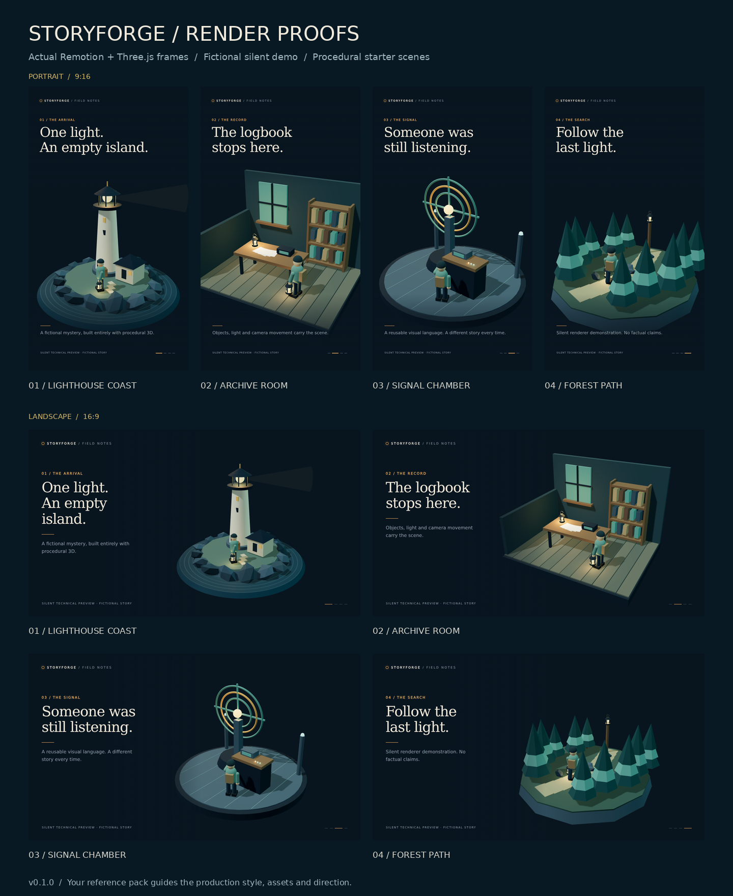
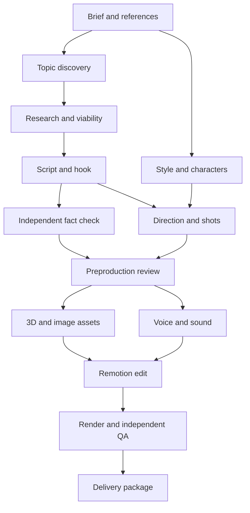

# StoryForge

**A local multi-agent production library for researched YouTube Shorts and long-form videos, built around Codex, Claude Code, Remotion, and Three.js.**

StoryForge gives the model a production team, a shared brief, a durable task graph, and concrete handoff contracts. It asks for your niche, approximate duration, format, audience, and references. It researches several angles, develops a hook and script, directs the scenes, creates or acquires assets and narration, edits and renders the film, reviews it, and assembles a delivery package.

Version **0.2.0** installs as a standalone CLI and sets up the production library inside any project. It includes **16 pipeline stages**, **18 role cards**, native agent definitions for both hosts, and a reusable scene renderer. Live research and paid generation use the capabilities and credentials available in your chosen host.

The coordinator, CLI transports, artifact checks, and procedural scenes are implemented. Automated checks use fake providers; the included visual proof contains eight actual rendered stills. A live, fully narrated production has not yet been exercised end to end. See the [workflow verification record](docs/VERIFICATION.md) and [renderer verification record](renderer/VERIFICATION.md) for exact coverage and limits.

## Install once, use in any project

With Python **3.11+**, Git, [pipx](https://pipx.pypa.io/latest/how-to/install-pipx.html), and Node **22+** with npm available:

```bash
pipx install git+https://github.com/CodnanBaig/storyforge.git
storyforge setup ./my-video-project
cd my-video-project
storyforge doctor
```

The public GitHub URL needs no GitHub token. The package includes its role cards, schemas, templates, host definitions, and renderer source, so you can use it without retaining a source checkout. The package name is `storyforge-video`; the command is `storyforge`. This release is installed from GitHub and has not been published to PyPI or npm.

On macOS, install pipx with `brew install pipx`, run `pipx ensurepath`, then open a new terminal. Install FFmpeg/ffprobe before producing or checking real narration and video. See the [installation guide](docs/installation.md) for prerequisites, a virtual-environment alternative, upgrades, and troubleshooting.

For an existing React, Next.js, or other project, run setup inside it:

```bash
cd path/to/your-project
storyforge setup
```

Setup adds a project-owned library and editable renderer under `.storyforge/`, installs the renderer's locked npm dependencies, and connects the selected coding agents. It preserves existing project instructions and app dependencies. Repeat setup safely; conflicting local edits are reported before generated files are replaced.

| Project file | Purpose |
| --- | --- |
| `storyforge.json` | Toolkit, renderer, run paths, and selected hosts |
| `.storyforge/WORKFLOW.md` | Project-specific producer entry point |
| `.storyforge/agents/`, `docs/`, `schemas/`, `templates/` | Reusable production library |
| `.storyforge/renderer/` | Editable Remotion and Three.js workspace with its own dependencies |
| `.storyforge/runs/` | Saved productions, task artifacts, media, and delivery files |
| `AGENTS.md`, `CLAUDE.md`, native agent folders | Project-scoped host instructions and worker definitions |

Use `storyforge setup --host codex` or `--host claude` to install one host's integration. `--host none` sets up only the library and renderer in a new project. Reruns retain existing integrations. `--skip-install` copies the project files without running npm; rerun setup later to install dependencies.

## Start a production in Codex or Claude Code

Open **your configured project folder** in Codex or Claude Code, then paste:

> Start StoryForge using .storyforge/WORKFLOW.md. Ask me for my niche, approximate video length, format, and references. Reuse any answers I have already given. Help me choose the hook style and narration, then run the specialist agents through research, script, direction, assets, voice, editing, rendering, and independent review. Keep checkpoints and continue through routine fixes within my budget. Return the actual reviewed video and its editable project, sources, captions, and publishing materials.

The native host acts as producer and is the recommended way to run a full production. It dispatches ready tasks in parallel, while each worker receives its role card, exact workspace and relevant artifacts. The same state and acceptance checks apply in both hosts. Default concurrency is three workers.

Intake asks for missing answers and reuses saved channel decisions. References can include videos, stills, character sheets, fonts, palettes, animation examples, voice references, existing Remotion projects and explicit dislikes. An instruction to propose a style is also valid.

The host needs live search for research and approved media tools or supplied assets for production. Setup does not log in to providers, launch model workers, or generate a film. See [host setup and coordination](docs/agent-hosts.md) for native agent loading, task claims, media reservations, recovery and permissions.

## Everyday commands

Run these from your project folder or one of its subfolders:

| What you want to do | Command |
| --- | --- |
| Collect a brief and create a saved run | `storyforge start` |
| Start from an existing brief | `storyforge start --brief my-brief.json` |
| See the active project and resource paths | `storyforge info` |
| Check runtimes, renderer dependencies, and available CLIs | `storyforge doctor` |
| Open the local Remotion Studio server | `storyforge studio` |
| Render stills from the included visual demo | `storyforge preview` |
| Preview your own renderer props | `storyforge preview --props draft.props.json` |
| Exercise the offline planning fixture | `storyforge demo` |

`start` collects input and creates state; hand the returned run directory to your host to begin production. `studio` prints a local URL for `StoryShort` and `StoryLong`. `preview` renders PNG stills into a new directory under `.storyforge/previews/`. Both included visual demos have a 45-second timeline; the landscape example demonstrates layout, not a complete long-form documentary. The separate offline `demo` command uses synthetic planning artifacts and deliberately stops at preflight.

The [CLI guide](docs/CLI.md) covers custom props, movie exports, task execution, and recovery.

## Actual render previews



These are code-rendered scenes from the fictional, silent technical demonstration. The starter library has four environments, a consistent customizable character, reusable props, three palettes, bundled fonts, and portrait/landscape layouts. Browse the [individual frames and their verification data](renderer/previews/README.md).

Your reference pack determines the production's visual style. The asset and editor agents author additional scenes, geometry and effects as the story requires.

## What is in the library

| Component | Implemented behavior |
| --- | --- |
| Intake | Niche, documentary/fiction/commentary, duration, ratio, audience, language, tone, all references, hook mode, voice preference, use intent, media limits |
| Producer | Sixteen dependent tasks; independent work can run in parallel; default three subprocess workers |
| Research | Candidate shortlist, source independence, claim ledger, uncertainty, current resolution check |
| Reach analysis | Observable demand/competition signals and transparent subjective prioritization; missing signals remain unknown |
| Writing | Three hook options, fixed/family/topic hook modes, spoken script, source-linked claims, long-form chapters |
| Direction | Scene purpose, action, camera, duration, assets, continuity and production feasibility |
| Visual system | A style bible, character identities, palette/typography rules, reusable procedural characters and props |
| Production | Separate Three.js, images, voice, sound, Remotion edit, and render roles |
| State | SQLite transactions, task leases, immutable snapshots, file hashes, dependency invalidation, events |
| Spending | Worker invocation limits; media cost/credit reservations; persistent provider job IDs; no retry on an uncertain generation |
| Quality | Independent fact check, preproduction checks, encoded media inspection, editorial/audio/visual review |
| Handover | Video, captions, script, sources, credits, metadata, editable project, QA evidence |

The eighteen model role cards are in [`agents/`](agents/): sixteen pipeline workers, the producer, and an advisory post-publication analyst. Native worker definitions are in [`.codex/agents/`](https://github.com/CodnanBaig/storyforge/tree/main/.codex/agents) and [`.claude/agents/`](https://github.com/CodnanBaig/storyforge/tree/main/.claude/agents) in this repository and are installed at your configured project's root. The full technical contract is in [`docs/contracts.md`](docs/contracts.md).

The editor drafts title/description/credits before independent QA. The final packager assembles the reviewed wording. The voice stage measures the opening against your configured hook limit using real alignment.

### YouTube script and creative reviewer

The bundled [creative-review agent](agents/youtube-creative-review-agent/) adds a strict preproduction review for The Unquiet Index's factual Shorts and compatible projects. It researches comparable YouTube videos, scores the script and visual plan, and returns APPROVE, REVISE, REJECT or BLOCKED. Approval requires at least 85/100 plus passing evidence, timing and creative checks; the score is editorial readiness, not a success probability.

Use it through the existing preflight worker and the host-run Node checker. Its instructions, schemas, executable gate and tests are included in installed projects at `.storyforge/agents/youtube-creative-review-agent/`. The [StoryForge integration guide](docs/creative-review.md) explains candidate mapping, revision handling and the boundary between the creative check and the existing Python, policy and budget gates.

## The production path



Long-form work uses chapters, section-level narration, continuity checks, and retention beats. It requires scene authoring suited to its length. Increasing a short template's duration does not create a long-form film.

## Hook consistency

Three modes are available in the brief:

- **`fixed`:** preserve your exact opening phrase and follow it with the episode's specific promise.
- **`family`:** keep the channel's rhetorical pattern while choosing fresh, story-specific wording.
- **`topic`:** let the story determine the opening.

`family` is the default. `fixed` is fully supported when that is your branding decision. All modes must deliver the promised payoff. A shared intro can coexist with substantial variation across the main content; the editorial review checks the whole episode and recent channel output. Consult the [policy and rights guide](docs/policy-and-rights.md) for current source-based guidance.

## Work from a terminal

For a new production in a configured project:

```bash
storyforge start
# Or use an existing validated brief:
storyforge start --brief my-brief.json
```

Use the returned run directory in subsequent commands. The native host can operate it with `next`, `claim`, `task`, and `submit`. A subprocess coordinator can instead launch already-authenticated CLI workers:

```bash
storyforge run .storyforge/runs/RUN_ID --provider codex --workers 3 --until preflight
# Or use --provider claude. Omit --until to attempt the full graph.
storyforge status .storyforge/runs/RUN_ID
```

For new paid-media requests, use the native host orchestrator to reserve the exact request and direct generation. The subprocess runner dispatches workers but has no interactive media-reservation broker: it returns a blocked stage when a new reservation is needed. Complete that handoff in the native host, submit the actual artifact, then resume the runner. Existing provider IDs and saved media paths are included in that task's next packet for recovery. Already supplied media and procedural code can proceed through the same graph without a new paid request.

`RUN_ID` is a placeholder for the actual directory printed by `start` or `init`; use its exact returned path if you are working in a subfolder. Model calls may use your provider plan or billable account. `max_model_calls` counts **worker dispatches** recorded by the subprocess runner or native `claim --model-call`, not every internal model turn or the producer's own reasoning. Claude also accepts an inner turn limit; Codex is bounded by the worker timeout. These controls are not a universal dollar cap for model usage.

See the [CLI guide](docs/CLI.md) for leases, recovery, media reservations, and actual output submission. For visual blocking from a director plan:

```bash
storyforge export-plan .storyforge/runs/RUN_ID --output draft.props.json
storyforge preview --props draft.props.json
```

This exports a labelled draft using starter environments. The editor must replace arbitrary environment choices and supply actual media before a production edit can pass.

## Examples and templates

- [45-second documentary mystery](examples/brief-mystery-short.json)
- [Eight-minute science documentary](examples/brief-science-long.json)
- [Original eerie fiction](examples/brief-fiction-short.json)
- [Exact recurring hook](examples/brief-fixed-hook.json)
- [`templates/`](templates/): research, story, direction, style, media, review and delivery structures.

References become a production specification. They do not automatically grant rights to reuse source footage, music, artwork, fonts, or voices.

## Repository map

| Path | Purpose |
| --- | --- |
| [AGENTS.md](AGENTS.md), [CLAUDE.md](CLAUDE.md) | Producer instructions and host-specific routing |
| [.codex/](https://github.com/CodnanBaig/storyforge/tree/main/.codex), [.claude/](https://github.com/CodnanBaig/storyforge/tree/main/.claude) | Native host configuration and worker definitions |
| [storyforge/](https://github.com/CodnanBaig/storyforge/tree/main/storyforge) | Python CLI, state store, task graph, contracts and provider adapters |
| [agents/](agents/) | Canonical specialist role cards |
| [renderer/](renderer/) | React, Remotion and Three.js scene library and export scripts |
| [schemas/](schemas/) | Brief, task-result and caption interchange schemas |
| [templates/](templates/), [examples/](examples/) | Editorial/production templates and example briefs |
| [tests/](https://github.com/CodnanBaig/storyforge/tree/main/tests) | Coordinator, transport, contract and recovery regression tests |
| [docs/](docs/) | Architecture, production, editorial and operating guides |

### Documentation

| Guide | Use it for |
| --- | --- |
| [Installation](docs/installation.md) | Install once, set up projects, upgrade, and resolve setup issues |
| [Agent hosts](docs/agent-hosts.md) | Run the producer and workers in Codex or Claude Code |
| [CLI](docs/CLI.md) | Commands, task leases, retries and media reservations |
| [Architecture](docs/architecture.md) | Extend the pipeline, providers or scene library |
| [Artifact contracts](docs/contracts.md) | Required handoffs and semantic acceptance checks |
| [Research and reach](docs/research-and-reach.md) | Topic evidence, prioritization and limits on performance claims |
| [Editorial](docs/editorial.md) | Hooks, script structure, factual framing and pacing |
| [YouTube creative review](docs/creative-review.md) | Use the bundled script reviewer and executable creative handoff check |
| [Production](docs/production.md) | References, assets, narration, editing and review |
| [Renderer](renderer/README.md) | Manifest input, local assets, stills and movie export |
| [Policy and rights](docs/policy-and-rights.md) | Release checks and current primary-source guidance |
| [Verification](docs/VERIFICATION.md) | Executed checks and live integrations still requiring a production run |

## Operational limits

The coordinator validates file existence, dependency freshness, claims and source identifiers, timings, budgets, and review records. **It cannot prove that a cited source is truthful, that a reference grants rights, or that a reviewer actually watched a film.** The assigned research and independent review agents must do that work and preserve evidence. The final reviewer must inspect the encoded film.

The starter renderer includes four authored environments and customizable procedural humans. Arbitrary niches need new geometry, scenes, props, and direction, authored by the asset and editor agents. Complex realism, motion capture, and custom rigging require additional assets or tooling. This library makes those additions modular; it does not claim to generate every visual style from primitives automatically.

Web-search, image-generation, voice, and asset providers must be available to the host or connected deliberately. No image-generation provider API is silently chosen. The optional ElevenLabs helper can generate a single approved script using your key and a reserved budget; long-form chapter splitting and assembly are the voice director's responsibility.

There is no automatic public uploader, scheduler, analytics scraper, or hosted dashboard in this release. The package role prepares files for an authorized release. The analytics role accepts real channel exports to inform the next episode. A finished package does not guarantee YouTube acceptance, monetization, or views.

## Development and verification

Clone the source only if you want to change StoryForge itself. Use a virtual environment for an editable developer install:

```bash
git clone https://github.com/CodnanBaig/storyforge.git
cd storyforge
python3 -m venv .venv
source .venv/bin/activate
python3 -m pip install -e .
python3 -m unittest discover -s tests -v
make test-review-agent
cd renderer
npm ci
npm run typecheck
npm run bundle
```

For actual scene previews, run from `renderer/`:

```bash
npm run validate -- --props examples/demo-short.json
npm run stills -- --props examples/demo-short.json --out previews/portrait --scale 0.5
npm run stills -- --props examples/demo-long.json --out previews/landscape --scale 0.5
```

Automated checks cover the state store, contracts, subprocess transports, media reservations, recovery, local media inspection, package resources, and project setup. Provider tests use fakes or mocked HTTP; they consume no generation credits. The eight reviewed PNGs verify representative stills, not narration, audio mixing, every animation frame or complete movie encoding. Full results and environment conditions are in the [workflow record](docs/VERIFICATION.md) and [renderer record](renderer/VERIFICATION.md).

When extending StoryForge, keep provider credentials out of the repository, preserve the standard-library Python core, and update a changed contract alongside its examples. Run focused tests for state, transport or validation changes. New visual work needs inspection in actual rendered frames before a complete export is accepted. See [architecture](docs/architecture.md) and [contributor instructions](AGENTS.md#maintaining-this-codebase).

## License

Original toolkit code is provided under the [MIT license](LICENSE). Dependencies and media keep their own licenses; see [third-party notices](THIRD_PARTY_NOTICES.md) and [official source notes](docs/SOURCES.md).
